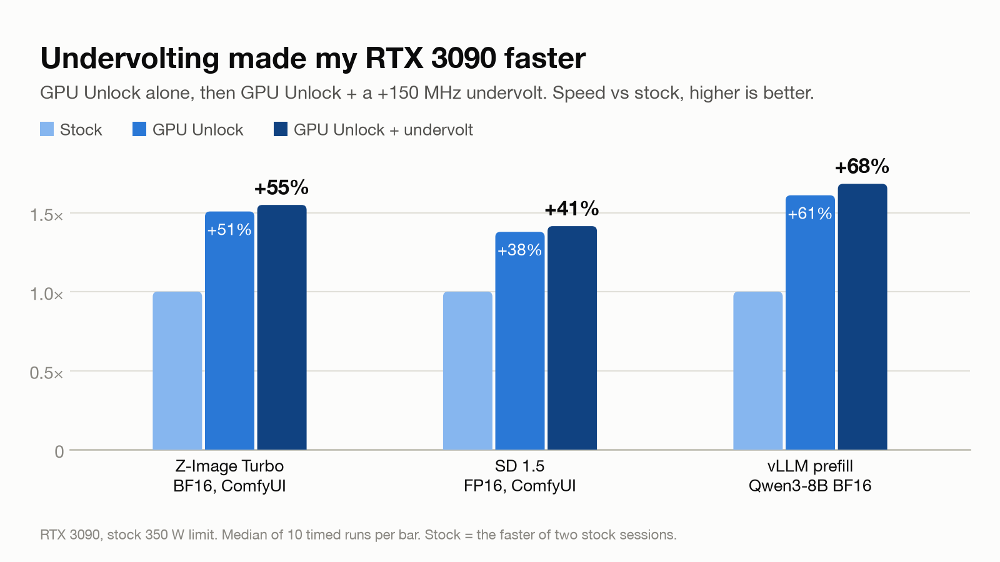
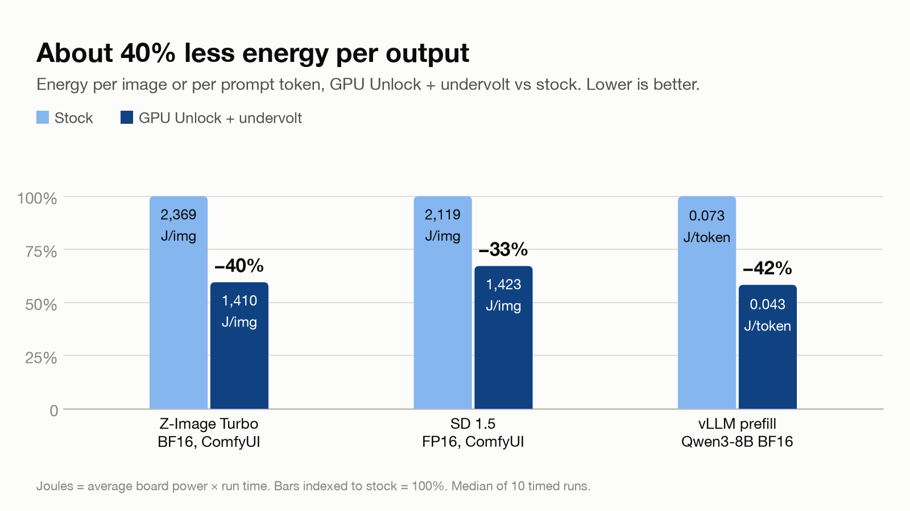
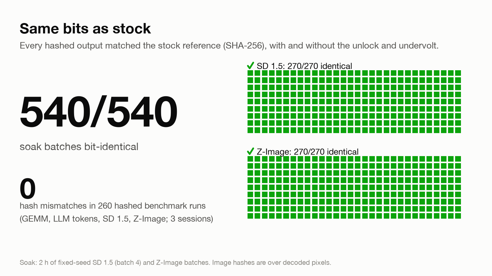

# Undervolting made my 3090 faster: GPU Unlock + a +150 MHz undervolt

[GPU Unlock](https://github.com/Zagitta/gpu-unlock) lifts the GeForce throttle on FP16/BF16 tensor-core math with FP32 accumulation on Ampere cards. On my RTX 3090 it made Z-Image Turbo 51% faster, SD 1.5 38% faster and vLLM prefill 61% faster. Adding my existing +150 MHz undervolt on top made all three faster still: **+55%, +41% and +68%**, at about **40% less energy per output**. Every hashed output stayed bit-identical to stock, including a 2-hour soak of 540 image batches.

Without the unlock, the same undervolt made the card 3–6% *slower*.



## Results

Median of 10 timed runs per cell. Gains are against the second stock session, which ran slightly faster than the first (see [Method](#method)), so they are the conservative figures.

| Workload | Stock | GPU Unlock | GPU Unlock + undervolt |
|---|---|---|---|
| Z-Image Turbo BF16, 1024², 8 steps | 7.46 s/img | 4.95 s/img (**+51%**) | 4.82 s/img (**+55%**) |
| SD 1.5 FP16, 1024², 30 steps, batch 4 | 6.40 s/img | 4.64 s/img (**+38%**) | 4.52 s/img (**+41%**) |
| vLLM prefill, Qwen3-8B BF16 | 4,662 tok/s | 7,505 tok/s (**+61%**) | 7,843 tok/s (**+68%**) |
| vLLM decode, batch 32 | 1,210 tok/s | 1,320 tok/s (+9%) | 1,317 tok/s (+9%) |
| vLLM decode, batch 1 | 49.4 tok/s | 51.1 tok/s (+3.5%) | 50.6 tok/s (+2.4%) |
| GEMM BF16, 8192³ | 71.0 TFLOPS | 115.1 (+62%) | 121.1 (+71%) |
| GEMM FP16, 8192³ | 69.7 TFLOPS | 112.3 (+61%) | 118.3 (+70%) |
| GEMM TF32, 8192³ | 37.8 TFLOPS | 62.8 (+66%) | 66.0 (+74%) |

Gains are throughput ratios: +55% means 1.55× the images per second. Every cell, with min and max, is in [`results/summary.txt`](results/summary.txt), regenerated by `python3 summarize.py results/session{1,2,3}/runs.csv`. The GEMM gains are in line with other 3090 reports upstream ([#165](https://github.com/Zagitta/gpu-unlock/issues/165), [#196](https://github.com/Zagitta/gpu-unlock/issues/196)), and the Z-Image time matches the after-unlock figure in [#27](https://github.com/Zagitta/gpu-unlock/issues/27).

## Why the undervolt helps

The undervolt is two settings, applied after boot:

- `nvidia-smi -lgc 210,1695` caps the core clock at 1695 MHz.
- A +150 MHz offset on the GPC voltage/frequency curve (`nvmlDeviceSetGpcClkVfOffset`), so each clock runs at a lower voltage.

The power limit stays at the stock 350 W.

At stock, the throttled tensor cores leave power headroom, and the card boosts past 1695 MHz on its own: stock prefill averaged 1,788 MHz. Capping the clock just costs speed. Within the same boot, the undervolt made the card slower on every image and prefill workload:

| Workload | Stock | Stock + undervolt |
|---|---|---|
| Z-Image | 7.74 s/img | 8.19 s/img (−5.5%) |
| SD 1.5 | 6.63 s/img | 6.82 s/img (−2.8%) |
| vLLM prefill | 4,535 tok/s | 4,303 tok/s (−5.1%) |

With the unlock, the tensor cores do much more work per clock, and the card runs into its 350 W limit instead. Prefill then averaged 1,599 MHz at 335 W. At a lower voltage, each clock costs less power, so under the same cap the undervolted card held 1,666 MHz at 334 W and went from 7,505 to 7,843 tok/s. Unlock + undervolt was the fastest cell on every GEMM, image and prefill workload.

## Energy



| Workload | Stock | GPU Unlock | GPU Unlock + undervolt |
|---|---|---|---|
| Z-Image | 2,369 J/img | 1,500 J/img | 1,410 J/img (**−40%**) |
| SD 1.5 | 2,119 J/img | 1,515 J/img | 1,423 J/img (**−33%**) |
| vLLM prefill | 0.073 J/token | 0.045 J/token | 0.043 J/token (**−42%**) |

Energy is board power from `nvidia-smi` (sampled every 0.5 s, samples under 60 W dropped) times run time. It doesn't include the rest of the system.

## Correctness



- **Soak:** 2 hours with GPU Unlock and the undervolt on, alternating fixed-seed SD 1.5 and Z-Image batches. All **540 batches** were SHA-256 identical to the stock reference, with no Xid errors and the GPU peaking at 68 °C.
- **Benchmark sessions:** **0 hash mismatches** across all 260 hashed runs: GEMM output tensors, decoded image pixels, and the greedy token IDs of 20 LLM prompts. No Xid errors in any session.

## Method

- **Three boots, Off → On → Off.** Session 1 at stock, a full power-off, session 2 with GPU Unlock loaded, then a power-off and session 3 at stock again. Session 3 checks for drift between boots: its stock cell ran 0.7–3.7% faster than session 1's, with the card cooler. The gains above use session 3, the faster stock.
- **ABBA blocks.** Within sessions 1 and 2, each workload ran undervolt off, on, on, off. Each block is 1 warm-up and 5 timed runs, so every cell has 10 timed runs. Session 3 ran two stock blocks.
- **Setup per session:** a 3-minute BF16 GEMM heat soak first. Only one GPU user at a time. Before every block, the runner checks the clock offset matches the cell, the power limit reads 350 W and no Xid has been logged. Any violation aborts the session.
- **Correctness:** SHA-256 of each GEMM output tensor, of the decoded pixels of each image batch, and of the LLM token IDs. Each hash is compared with a reference recorded at stock in a separate boot (`results/reference.json`).
- **Workloads:**
  - GEMM: `torch.mm`, 8192³, FP32 accumulation.
  - vLLM: the `vllm bench throughput` code path. Prefill is 200 prompts of 4096 tokens in, 1 out. Decode is 128 in, 512 out.
  - Images: through the ComfyUI API, timed from `execution_start` to `execution_success`, with the loaders and text encoders cached.

  Details are in [`bench.py`](bench.py), `gemm_worker.py` and `vllm_worker.py`.

Raw data for each session is in `results/<session>/`:

- `runs.csv`: one row per timed run;
- `samples.csv`: every 0.5 s `nvidia-smi` sample;
- `env.json`: versions, kernel log lines from the module, and model hashes;
- `llm_tokens.jsonl`.

The `dryrun-*` and `stock-ref*` directories are the dry runs and the reference runs.

## Hardware and software

| | |
|---|---|
| GPU | NVIDIA GeForce RTX 3090 (GA102, `10de:2204`), VBIOS 94.02.42.00.02, 350 W default power limit |
| Driver | 595.71.05 |
| OS | NixOS 26.05, Linux 6.18.48 |
| GPU Unlock | 1.0.0, commit [`990a14e`](https://github.com/Zagitta/gpu-unlock/commit/990a14e9b7dc8eaad8e6925133aa0e8382efe6cf), firmware assets from NVIDIA 610.43.03 |
| vLLM | 0.32.0, torch 2.13.0, flashinfer-python 0.7.0.post1, triton 3.7.1, Python 3.13.15 |
| ComfyUI | commit `87ed5a0`, torch 2.14.1, triton 3.8.0 |
| LLM | [`Qwen/Qwen3-8B`](https://huggingface.co/Qwen/Qwen3-8B) @ `b968826d`, BF16, `max_model_len` 8192 |
| Image | [`Comfy-Org/Z-Image-Turbo`](https://huggingface.co/Comfy-Org/Z-Image-Turbo) @ `6fc90a3b` (BF16 split files), `v1-5-pruned-emaonly-fp16.safetensors` |

## How to reproduce

### 1. Unlock

Read [upstream's README](https://github.com/Zagitta/gpu-unlock) first and check that it supports your card. On NixOS, import [`nixos/gpu-unlock.nix`](nixos/gpu-unlock.nix). It builds GPU Unlock 1.0.0 and its firmware assets, loads the module from the initrd so it runs before `nvidia` binds, and adds a `stock` boot entry without the unlock:

```nix
{
  imports = [ ./nixos/gpu-unlock.nix ];
  services.gpu-unlock = {
    enable = true;
    targets = [ "0000:01:00.0" ]; # your card, from `lspci -D -d 10de:`
  };
}
```

On other distributions, use upstream's packaging.

> [!WARNING]
> **A failed unlock leaves the GPU unusable until a full power-off**, and **a reboot does not revert the unlock**. Only a cold power-off resets the card. Before the first unlocked boot, make sure you can power-cycle the machine (be at it, or have remote power control), and keep the `stock` entry to boot after that power-off.

Power off fully, boot, then check that the unlock happened before the driver loaded:

```sh
journalctl -k -b | grep -E 'gpu_unlock|NVRM'   # "gpu_unlock: unlocked" before the first NVRM line
```

### 2. Undervolt

```sh
nvidia-smi -lgc 210,1695
python3 -c 'import pynvml as n; n.nvmlInit(); n.nvmlDeviceSetGpcClkVfOffset(n.nvmlDeviceGetHandleByIndex(0), 150)'
# back to stock: offset 0, then nvidia-smi -rgc
```

+150 MHz is what this card passed. Soak-test your own offset (`./run.sh soak`) before trusting its outputs: an unstable offset can produce wrong results without crashing.

### 3. Benchmark

The runner expects:

- a systemd unit that applies the undervolt on start and restores stock on stop (`UNDERVOLT_UNIT`, default `gpu-tune`);
- ComfyUI as a systemd unit, with the models above;
- a vLLM 0.32.0 venv and the Qwen3-8B snapshot under `$BENCH_DIR`.

`bench.py` lists every variable. As root:

```sh
export BENCH_DIR=/path/to/state COMFY_DIR=/path/to/comfyui
./run.sh stock-ref                          # reference hashes at stock
./run.sh session --session 1 --unlock off   # power off, boot unlocked, then:
./run.sh session --session 2 --unlock on
./run.sh soak --unlock on --undervolt on --hours 2
./run.sh session --session 3 --unlock off   # after a power-off back to stock
python3 summarize.py results/session{1,2,3}/runs.csv > results/summary.txt
uv run charts/make_charts.py
```

## Caveats

- **One card.** Results vary by card, partner board, VBIOS and cooling, and so does the undervolt a card can hold.
- **Reverting needs a full power-off.** A reboot keeps the unlock, and a failed unlock leaves the GPU unusable until power-off (upstream [#23](https://github.com/Zagitta/gpu-unlock/issues/23), [#184](https://github.com/Zagitta/gpu-unlock/issues/184)).
- **Single-user LLM chat barely moves.** Batch-1 decode is memory-bandwidth-bound and gained only 2–4%. The gains are in prefill, batched work and image generation.
- **Only the throttled path speeds up.** The gains apply to FP16/BF16/TF32 tensor math with FP32 accumulation. INT8-quantized paths such as llama.cpp's Q4/Q8 kernels showed little or no gain in upstream reports ([#202](https://github.com/Zagitta/gpu-unlock/issues/202)).
- **Not tested with suspend.** The module runs with `gpu_unlock.resume=0`.
- The module patches NVIDIA firmware in memory at boot; NVIDIA's driver license prohibits modifying its binaries, so judge that for yourself.

## Credit and licence

All the unlock work is [Zagitta/gpu-unlock](https://github.com/Zagitta/gpu-unlock) and its contributors. This repo only measures it. A NixOS flake for it is also proposed upstream in [#186](https://github.com/Zagitta/gpu-unlock/pull/186).

- Code in this repo (scripts and the NixOS module): [MIT](LICENSE).
- Data and charts (`results/`, `charts/*.png`): [CC BY 4.0](LICENSE-DATA).
- `nixos/gpu-unlock.nix` fetches GPU Unlock (GPL-2.0) and NVIDIA's driver files at build time. Neither is included here.
